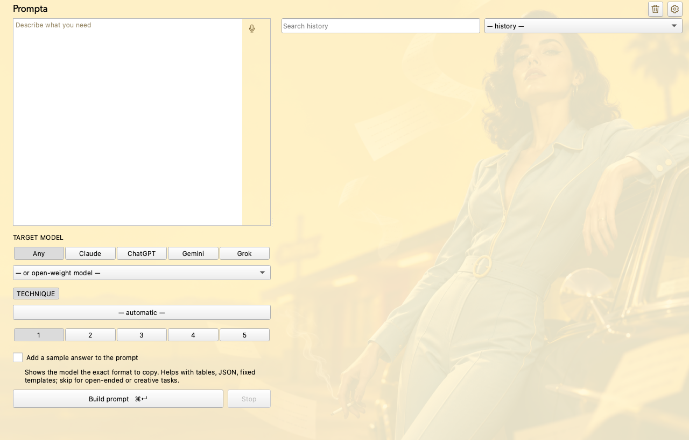

# Prompta — prompt generator for Claude, ChatGPT, Gemini and Grok

Turn a messy stream of thoughts into a ready prompt, with a zero-shot baseline to compare.

```bash
python3 -m pip install PyQt6
```



Runs on Ollama, no key · Official guides with source links · MIT

---

## Quick start

You need Node.js 22.18+ and Python 3.12. The pipeline itself has no npm dependencies. In the repository root:

```bash
python3 -m pip install PyQt6 && python3 desktop/app.py
```

The macOS window opens; pick a provider and model in Settings. Or run the same pipeline from the terminal
on an Ollama cloud model (through the local Ollama daemon, no API key):

```bash
npm run pipeline -- "sort support emails into billing/shipping/returns, strict JSON" --provider ollama --model deepseek-v4.1-flash:cloud
```

```
Задача: Classify support emails into billing, shipping, or returns and return strict JSON.
Тип: classification | язык: en | цена ошибки: medium
...
Техника: Few-shot (one-shot) (few_shot), уверенность 86%
Почему не дешевле: zero_shot is cheaper but cannot reliably enforce the strict JSON schema and category boundaries, so it is not suitable here.
...
Расход: 4 вызовов, токены 5212 → 10632
Предупреждения: Prompt-injection guard added: input material is treated as data
Отсеяно до выбора: 80 техник
```

The run took 43 s. CLI labels are in Russian; the prompt follows the language of the request.

## Turn a rough request into a structured prompt

Write what you want the way you would say it. Prompta parses it into a brief (goal, format,
constraints, assumptions), asks up to 3 questions about missing facts, picks the cheapest of
89 catalogued techniques that fits, and builds 1–5 prompt variants plus a zero-shot baseline.

```bash
npm run pipeline -- "summarise meeting notes into action items with owners" --provider ollama --model deepseek-v4.1-flash:cloud --budget 1
```

`--budget 1` keeps only one-call techniques: in this run 81 were filtered out and it chose
`contextual_prompting`. In the app, edit the **What I assumed** card and press
**Rebuild** to regenerate from the corrected brief.

## Write prompts from official Claude, ChatGPT, Gemini and Grok guides

Pick **For Claude**, **For ChatGPT**, **For Gemini**, **For Grok** or **Hermes** in the app. The prompt is
then compiled only from rule sets saved in `*_prompt_rules/` and `hermes_agent_prompt_guides/`, and each
result lists the rule IDs and official source links it used. 15 open-weight models (DeepSeek, GLM, Kimi,
Mistral, Gemma, gpt-oss and others) have their own saved guides in `open_model_prompt_guides/`.

The generator model stays whatever you selected; the target only decides which rules apply.

## Improve prompts from Claude Code or Cursor via MCP

The MCP server exposes two tools to any MCP client: `improve_prompt` (rough request → structured prompt,
`target`: `auto`, `claude`, `chatgpt`, `gemini`, `grok`, `hermes`) and `suggest_next_prompts`
(conversation → next messages to send).

```bash
claude mcp add prompta -e PROMPTA_MODEL=deepseek-v4.1-flash:cloud -- node /absolute/path/to/prompta/mcp/server.ts
```

Then ask the agent "improve this prompt with prompta for Claude". Config for Cursor and Claude Desktop is in
[mcp/README.md](mcp/README.md).

## How it works

The desktop app, the CLI and the MCP server all call the same TypeScript pipeline; the PyQt6 window talks
to it through `desktop/bridge.ts` (JSON in, JSON out). Each stage's model output is validated: an unknown
task type or a technique outside the catalog is an error, not a guess. Techniques without a template are
gated out before the model sees them. Pasted documents and agent context are passed as delimited data,
and prompts that process third-party material get a data-not-instructions rule.

```
thoughts → brief → technique gate → selection → synthesis → prompt + zero-shot baseline
```

## Configuration

| Option (`npm run pipeline`) | Default | What it does |
|---|---|---|
| `--provider` | `gemini` | `gemini`, `openai`, `ollama`, `anthropic` or `xai` |
| `--model` | `gemini-2.5-flash` | Generator model name, e.g. `deepseek-v4.1-flash:cloud` with `ollama` |
| `--budget` | from the brief | Maximum model calls a technique may need |
| `--deterministic` | off | Fill the technique template without the synthesis call |
| `--execution-profile` | `universal` | Where the prompt runs: `universal`, `web`, `local` or `agent` |
| `--agent-capabilities` | none | With `agent`: comma list of `web`, `files`, `code`, `integrations` |
| `--json` | off | Print the full result as JSON |

### Environment variables

Read from the environment or `.env.local` in the repository root.

| Variable | Required | What it does |
|---|---|---|
| `GEMINI_API_KEY` · `OPENAI_API_KEY` · `ANTHROPIC_API_KEY` · `XAI_API_KEY` | for that provider | Provider key |
| `OLLAMA_HOST` | no | Ollama address; `https://ollama.com` for Ollama Cloud without a daemon, with `OLLAMA_API_KEY` |
| `PROMPTA_PROVIDER` · `PROMPTA_MODEL` · `PROMPTA_API_KEY` · `PROMPTA_BASE_URL` | no | MCP server model settings; default provider `ollama` |
| `PROMPTA_HISTORY_MAX` · `PROMPTA_HISTORY_DAYS` | no | Desktop history size (default 500, `-1` turns it off) and age limit |

## Requirements

- Node.js 22.18+ (runs `.ts` files directly; CI uses Node 22)
- macOS for the desktop app (documented as macOS 12+), Python 3.12 with PyQt6
- Pipeline, CLI and MCP server: macOS or Linux (offline tests run on Ubuntu in CI)
- A model: Ollama (local or `:cloud`, no key), or an API key for Gemini, OpenAI or a compatible API, Anthropic, xAI
- Optional dictation: faster-whisper in `.venv-whisper` ([setup](desktop/README.md#local-whisper-dictation))

## Limitations

- No signed or downloadable build: the app runs from source, and `build_app.sh` makes a local launcher only.
- Windows is untested; the desktop app is macOS only.
- The CLI has no target flag; official-guide targets are in the desktop app and the MCP server.
- One request at a time in the app; a build takes tens of seconds (43 s in the example above).
- Official rule sets are dated snapshots; `source-drift` CI flags upstream changes but does not update them.

<details>
<summary>macOS app bundle, keys and privacy, development</summary>

### macOS app bundle

```bash
./desktop/build_app.sh && open release/Prompta.app
```

### Keys and privacy

History is local, in `~/Library/Application Support/Prompta/history.sqlite3`, owner-only, without API keys.
With **Remember in Keychain** on, the app saves keys in the macOS login Keychain. Connecting the MCP server
from the app writes the key into that client's MCP config. MCP context is trimmed and secrets are redacted.

### Development

```bash
npm install && npm test && npm run typecheck && python3 catalog/validate.py
```

Live evaluation (28 tasks, 10 with injected commands, rubric judge, regression gate) is in [eval/](eval/README.md).

</details>

---

<div align="center">

  [](https://github.com/KazKozDev/prompta/actions/workflows/ci.yml) [](.github/workflows/ci.yml) [](LICENSE)

<!-- TODO(user): append " · [LinkedIn](url)" -->
[Issues](https://github.com/KazKozDev/prompta/issues) · [License](LICENSE) · [Pipeline](pipeline/README.md) · [MCP server](mcp/README.md) · [Desktop app](desktop/README.md) · [Evaluation](eval/README.md)

</div>
