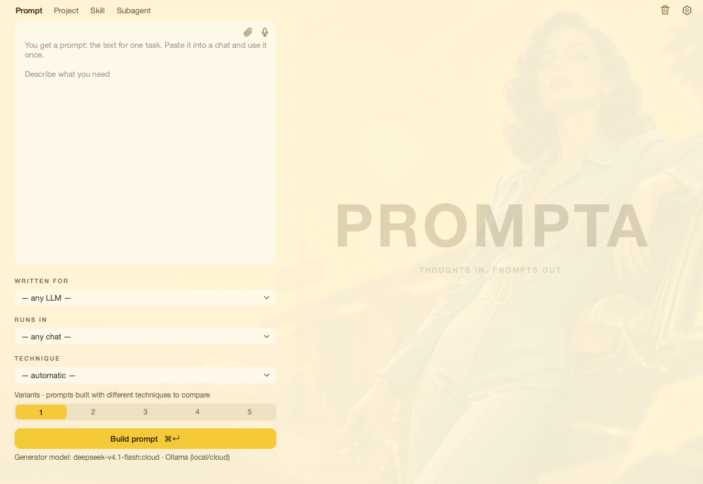

# prompta

Prompta turns a rough, stream-of-thoughts request into a structured prompt for Claude, ChatGPT, Gemini, Grok or an open-weight model, and gives you a zero-shot baseline to compare it against.



The GIF is a real run of the desktop app on `deepseek-v4.1-flash:cloud`. The wait for the model is sped up; the run itself took about a minute.

There is one TypeScript pipeline in `pipeline/` and three ways to call it: a PyQt6 window for macOS, a CLI and an MCP server. The pipeline itself has no npm dependencies. Node 22.18+ runs the `.ts` files directly (`package.json` engines), so there is no build step.

## install

You need Node.js 22.18+ and Python 3.12 (the version CI uses). From the repo root:

```
python3 -m pip install -r desktop/requirements.txt
```

This installs pinned PyQt6, which only the desktop app needs. The CLI and MCP server need nothing beyond Node. Dev tools for tests and typechecking:

```
npm ci
```

## quick start

Desktop app (macOS):

```
python3 desktop/app.py
```

Pick a provider and model in Settings. CLI, on an Ollama cloud model through the local Ollama daemon (no API key needed):

```
npm run pipeline -- "sort support emails into billing/shipping/returns, strict JSON" --provider ollama --model deepseek-v4.1-flash:cloud
```

what you should see (abridged, from an earlier run of this command):

```
Task: Classify support emails into billing, shipping, or returns and return strict JSON.
Type: classification | language: en | stakes: medium
Technique: Few-shot (one-shot) (few_shot), confidence 86%
Why not cheaper: zero_shot is cheaper but cannot reliably enforce the strict JSON schema ...
Usage: 4 calls, tokens 5212 → 10632
Warnings: Prompt-injection guard added: input material is treated as data
Filtered out before selection: 80 techniques
```

That run took 43 s. The output depends on the model, so yours will differ.

MCP server for Claude Code (two tools: `improve_prompt` and `suggest_next_prompts`):

```
claude mcp add prompta -e PROMPTA_MODEL=deepseek-v4.1-flash:cloud -- node /absolute/path/to/prompta/mcp/server.ts
```

Config for Cursor and Claude Desktop is in `mcp/README.md`.

## how it works

```
thoughts → brief → technique gate → selection → synthesis → prompt + zero-shot baseline
```

`brief.ts` parses the request into a brief: goal, format, language, stakes and call budget. The clarify step asks up to 3 questions about missing facts. `catalog.ts` then filters the 90 techniques in `catalog/catalog.json` deterministically, by type, status and budget, before the model sees any of them. `select.ts` picks the cheapest technique that fits and says why nothing cheaper would work. `synthesize.ts` fills that technique's template. An unknown task type or a technique outside the catalog is an error, not a guess.

With a named target (`claude`, `chatgpt`, `gemini`, `grok`, `hermes`), the prompt is compiled only from the saved rule sets in `*_prompt_rules/` and `hermes_agent_prompt_guides/`, and the result lists the rule IDs and source links it used. 15 open-weight models have their own saved guides in `open_model_prompt_guides/`. The generator model stays whatever you picked; the target only decides which rules apply.

Pasted documents and agent context go in as delimited data. A prompt that processes someone else's material gets a data-not-instructions rule (`injection.ts`).

## cli flags

From `pipeline/cli.ts`:

- `--provider` - `gemini` (default), `openai`, `ollama`, `anthropic`, `xai`
- `--model` - generator model, default `gemini-2.5-flash`
- `--budget N` - max model calls a technique may need; by default taken from the brief
- `--deterministic` - fill the template without the synthesis call
- `--execution-profile` - `universal` (default), `web`, `local`, `agent`
- `--agent-capabilities` - with `agent`: comma list of `web,files,code,integrations`
- `--json` - print the full result as JSON

Keys come from the environment or `.env.local` in the repo root: `GEMINI_API_KEY`, `OPENAI_API_KEY`, `ANTHROPIC_API_KEY`, `XAI_API_KEY`. For Ollama, set `OLLAMA_HOST`, plus `OLLAMA_API_KEY` for the direct ollama.com API. The MCP server reads `PROMPTA_PROVIDER` (default `ollama`), `PROMPTA_MODEL`, `PROMPTA_API_KEY` and `PROMPTA_BASE_URL`.

## layout

- `pipeline/` - the pipeline; start at `cli.ts`, then `brief.ts`, `select.ts`, `synthesize.ts`. `llm.ts` has the provider adapters on plain `fetch`
- `catalog/` - the technique catalog and its validator `validate.py`
- `*_prompt_rules/`, `hermes_agent_prompt_guides/`, `open_model_prompt_guides/` - dated snapshots of the official guides, plus the rules taken from them
- `agent_rules/`, `skill_rules/`, `instructions_rules/` - rules for writing agent prompts, skills and AGENTS.md-style instruction files
- `desktop/` - the PyQt6 app; `bridge.ts` passes JSON between the window and the pipeline, so no pipeline logic lives in Python
- `mcp/server.ts` - the MCP server
- `eval/` - live evaluation: 28 tasks in `tasks.json`, a rubric judge and a regression gate

## tests

```
npm test && npm run typecheck && python3 catalog/validate.py
```

The offline tests run on Ubuntu in CI, and the desktop tests on macOS. To run the CI lint and type gates before every commit:

```
git config core.hooksPath .githooks
```

## notes

- The desktop app is macOS only. Windows is untested.
- `./desktop/build_app.sh` makes a local launcher. `./desktop/build_standalone.sh` makes an Apple Silicon `.app` and `.dmg` that is signed ad hoc and not notarized, so on another Mac the first launch has to be allowed in Privacy & Security. See `desktop/README.md`.
- The CLI has no target flag. Named targets are available in the desktop app and the MCP server.
- The app runs one request at a time, and a build takes from tens of seconds to about a minute, depending on the model (43 s and 59 s in the two runs above).
- The official rule sets are dated snapshots. The `source-drift` workflow flags upstream changes but does not update the snapshots.
- History is stored locally in `~/Library/Application Support/Prompta/history.sqlite3`, without API keys. Keys go to the macOS Keychain only if you turn on Remember in Keychain.

## license

MIT, see `LICENSE`.
